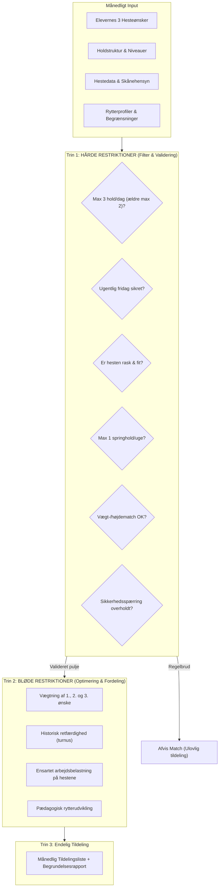

# PROJEKT-CONSTITUTION: DIGITAL HOLDADMINISTRATION & HESTETILDELING
**Pilotprojekt:** Bøgegårdens Ridecenter & Dansk Rideforbund  
**Udarbejdet af:** AI-Native Konsulentteam (3. Semester Tværfagligt Projekt)  
**Dokumenttype:** Projektets Grundlov, Domænekontrakt og Arkitektoniske Guardrails  
**Version:** 1.0  
**Status:** Godkendt & Gældende  

---

## 1. VISION & PRÆAMBEL

### 1.1 Formål og Kontekst
Dette projekt udgør et strategisk pilotprojekt for **Dansk Rideforbund** med **Bøgegårdens Ridecenter** i Strandby som pilotvirksomhed. Formålet er at konceptualisere, analysere og designe en skræddersyet, digital løsning, der fjerner administrativt spild, højner hestevelfærden, professionaliserer elev- og fremmøderegistreringen og automatiserer den komplekse månedlige hestetildelingskabale.

### 1.2 Opgavens Afgrænsning (Scope)
Projektets primære fokusområde er afgrænset jf. scoping-aftalen til processen:
> **»Holdadministration, elevregistrering og hestetildeling«**

*   **Processtart:** Månedsskifte (indsamling af hesteønsker, opdatering af holdlister).
*   **Processlut:** Opdateret digital afkrydsningsliste, gennemført undervisningstime, revisionssikker elevregistrering til kommunal støtte samt dokumenteret overholdelse af dyrevelfærd.
*   **Volumen/Frekvens:** 4 faste undervisere + afløsere, ca. 2-4 staldelever/hjælpere, 3 ugentlige hverdage + weekender med op til 4-5 hold dagligt (max 10 elever pr. hold).

### 1.3 Konstitutionens Retskraft (Governance)
Denne Constitution er det **øverste styringsdokument** for projektet. Alle efterfølgende artefakter – herunder AS-IS/TO-BE procesmodeller (BPMN), SIPOC, 5 Why’s analyser, arkitekturdiagrammer, datamodeller og Proof-of-Concept (POC) prototyper – er underlagt reglerne, principperne og begrænsningerne defineret i dette dokument.

---

## 2. DE 5 KARDINALPRINCIPPER (NON-NEGOTIABLES)

Projektets løsninger og systemdesign skal ubetinget efterleve følgende fem grundpiller:

```
+-----------------------------------------------------------------------------------+
|                           DE 5 KARDINALPRINCIPPER                                |
+-----------------------------------------------------------------------------------+
|  1. HESTEVELFÆRD FØRST      : Dyrevelfærd og helbred trumfer ALTID elevønsker.   |
|  2. SIKKERHED & MATCH       : Fysisk og mentalt match eliminerer ulykker.         |
|  3. REVISIONSSIKKERHED      : Kommunal dokumentation sikrer økonomisk eksistens.  |
|  4. DATAETIK & GDPR         : Skånsom, lovlig forvaltning af tavs og følsom viden.|
|  5. SINGLE SOURCE OF TRUTH  : Ét fælles sandhedspunkt erstatter whiteboards & SMS.|
+-----------------------------------------------------------------------------------+
```

### Princip I: Hestevelfærd Først (Animal Welfare Above All)
Dyrevelfærden for rideskolehestene er en ufravigelig grænse. Hverken forældrepres, elevønsker eller holdoptimering må kompromittere hestens fysiske eller mentale helbred. Systemet skal gøre det umuligt at overbooke eller overbelaste en hest.

### Princip II: Ryttersikkerhed og Fysiologisk Match
Ridesport indebærer iboende risici for alvorlige rideulykker. Tildeling af heste må aldrig baseres på vilkårlig lodtrækning eller udelukkende popularitet. Systemet skal sikre absolut kompatibilitet mellem hestens temperament/bæreevne og rytterens niveau, vægt, højde og psykiske robusthed.

### Princip III: Revisionssikkerhed og Kommunal Compliance
Bøgegårdens Ridecenter modtager afgørende kommunal støtte til fritidstilbud for børn og unge. Uretmæssigt modtaget eller udokumenteret støtte kan medføre krav om tilbagebetaling og bortfald af støtte, hvilket truer stedets eksistens. Fremmøderegistrering og medlemslister skal være uforgængelige, transparente og revisionssikre.

### Princip IV: Dataetik, GDPR og Beskyttelse af »Tavs Viden«
Informationer om elevers diagnoser (f.eks. angst), ridefrygt, familieforhold samt hestes adfærdsproblemer er personfølsomme oplysninger (GDPR Art. 9) og fortrolig faglig viden. Systemet skal designes med Privacy by Design, rollebaseret adgangskontrol og adskillelse mellem administrative data og pædagogiske/faglige observationer.

### Princip V: Single Source of Truth (SSoT) i et Hårdt Staldmiljø
Slut med divergerende versioner mellem kontor-pc’er, private SMS’er, A4-ringbind i stalden og udviskede whiteboard-tavler. Enhver ændring (syge heste, vikarer, elevflytninger) skal reflekteres i realtid i ét centralt system, som skal kunne tilgås fejlfrit under barske fysiske staldforhold (støv, fugt, handsker, manglende pauser).

---

## 3. DOMÆNEREGLER & TILDELINGSKABALE (CONSTRAINTS)

Algoritmen og processen for tildeling af heste til ryttere skal opdeles i **Hårde Restriktioner** (som aldrig må brydes under nogen omstændighed) og **Bløde Restriktioner** (som optimeres med størst mulig tilfredshed).



### 3.1 Hårde Restriktioner (Hard Constraints - Absolute Rules)

| ID | Restriktion | Regelbeskrivelse | Datakilde & Validering |
|---|---|---|---|
| **HC-01** | **Dagsbelastning (Normale heste)** | En hest må **højst gå 3 hold på en enkelt dag**. | Hestevelfærdskrav. Valideres på dags- og holdniveau. |
| **HC-02** | **Dagsbelastning (Skåne-/Seniorheste)** | Ældre heste eller heste med nedsat kapacitet må **højst gå 2 hold på en dag**. | Malenes faglige vurdering (f.eks. hestens alder/slitage). |
| **HC-03** | **Ugentlig Hviledag** | Enhver rideskolehest skal have **mindst 1 fuld ugentlig fridag** uden lektioner. | Ugeplan / Holdoversigt. |
| **HC-04** | **Sundhedstilstand (Sygdom/Skade)** | Syge, halte eller skadede heste må **under ingen omstændigheder** bookes eller deltage. | Løbende hestemanagement. Status: Aktiv / Sygemeldt. |
| **HC-05** | **Springfrekvens & Forbud** | En hest må **højst springe 1 gang om ugen**. Heste med springforbud må ALDRIG tildeles springhold. | Heste med forbud: *Bølle* (et øje), *Wally*, *Aida*. *Arthur* må max deltage på 1 springhold. |
| **HC-06** | **Fysisk Vægt- & Størrelsesmatch** | Rytterens vægt/højde skal matche hestens bæreevne. Tunge ryttere må ikke tildeles små ponyer eller sarte heste. | *Wally* (115 cm): Kun lette ryttere.<br>*Missy* (144 cm): Ikke tunge ryttere.<br>*Sara Troelsen* (tung): Må kun have store, bæredygtige heste.<br>*Clara Bjerg / Johanne Johansen* (høje): Kræver store heste (Aslan, Belle, Boy, Rosa). |
| **HC-07** | **Traume- & Sikkerhedsspærringer** | Absolutte match-forbud baseret på ulykkeshistorik, diagnoser og panikrisiko. | • *Anna Gammelgård* (angstdiagnose): Må **KUN** ride *Donny*.<br>• *Emma Grønby* (brækket arm efter styrt): Må **IKKE** ride *Pixie*.<br>• *Sofia Ejby* (smidt af og bange): Må **IKKE** ride *Aida*.<br>• *Filippa Udby* (nervøs/uerfarne forældre): Kræver altid 100% rolige heste (*Aslan*, *Toobi*).<br>• Nervøse ryttere / rideangst: Forbudt på *Boy*, *Pixie*, *Freya*. |
| **HC-08** | **Holdniveau-Kvalifikation** | Elever må kun tildeles heste, hvis temperament matcher holdets faglige niveau. | • *Begynder:* Kræver rolige heste (Aslan, Toobi, Jane, Belle). Urolige/friske heste (Cornelius, Pixie, Freya) er forbudt.<br>• *Arthur:* Må ikke benyttes på øvede hold.<br>• *Parthold:* Rytter rider fast parthest (f.eks. Freja P. & Lærke H. på hhv. Belle & Aida). |

### 3.2 Bløde Restriktioner (Soft Constraints - Optimization Goals)

| ID | Restriktion | Beskrivelse & Vægtning |
|---|---|---|
| **SC-01** | **Elevønsker (1., 2. og 3. prioritet)** | Systemet stræber efter at opfylde elevernes ønsker (1. ønske vægtes højest, derefter 2. og 3.). |
| **SC-02** | **Historisk Retfærdighed (Turnus)** | Hvis en elev i forrige måned måtte nøjes med sit 2. eller 3. ønske (eller et kompromis), tildeles eleven højere prioritet ved tildeling af eftertragtede heste (*Toobi*, *Belle*, *Donny*) i den nye måned. |
| **SC-03** | **Jævn Belastningsfordeling** | Arbejdsbyrden spredes jævnt over hesteflåden, så populære heste ikke konsekvent presses til grænsen af deres tilladte holdkvote. |
| **SC-04** | **Pædagogisk Progression** | Ryttere, der er klar til udvikling, udfordres progressivt med heste, der matcher deres næste udviklingstrin, uden at skabe utryghed. |
| **SC-05** | **Hjælper-præferencer** | Erfarne staldelever/hjælpere tildeles passende heste til deres gratis ridetime som anerkendelse for staldarbejdet, uden at blokere for betalende elevers primære undervisning. |

---

## 4. STAKEHOLDER-ARKITEKTUR & ROLLER (RACI)

```
+------------------+---------+------------+----------+----------+-----------+---------+
| Proces / Opgave  | Malene  | Ridelærer  | Hjælpere | Elever / | Kommunen  | Dansk   |
|                  | (Ejer)  | (4 faste)  | (Stald)  | Forældre | (Støtte)  | Ridefb. |
+------------------+---------+------------+----------+----------+-----------+---------+
| Månedlig tildeling| Account.| Respon./Udf| Inform.  | Consult. | -         | Inform. |
| Sygemelding hest | Account.| Respon./Udf| Respon.  | Inform.  | -         | -       |
| Fremmøderegistr. | Account.| Respon./Udf| Inform.  | Inform.  | Inform.   | -       |
| Hestevelfærdsktr.| Account.| Respon.    | Inform.  | -        | -         | Inform. |
| Kommunal indberet| Respon. | Inform.    | -        | -        | Account.  | -       |
+------------------+---------+------------+----------+----------+-----------+---------+
* Forklaring: Respon. = Responsible (Udførende), Account. = Accountable (Hovedansvarlig), Consult. = Consulted (Høres), Inform. = Informed (Orienteres).
```

### 4.1 Nøgleroller og Operationelt Ansvar
1.  **Malene (Ejer & Driftsansvarlig):**
    *   Endeligt ansvarlig for hestevelfærd, holdstruktur, økonomi og kommunal dokumentation.
    *   Ofte fraværende pga. datteren Stellas internationale elitestævner; kræver remote monitorering og tillid til systemets automatiske kontrol.
2.  **Ridelærerne (Marie, Camilla, Birgit, Malene + Vikarer):**
    *   Møder 30 min. før første undervisningstime.
    *   Gennemfører undervisning, leder skovture, modtager prøvetimebørn og foretager fremmødekontrol.
    *   Har hidtil brugt 0,5 - 2 ulønnede timer pr. måned på at samle ønsker og manuelt fordele heste.
    *   Har 0 minutters pause mellem holdene, hvilket kræver lynhurtig afklaring ved uforudsete hændelser.
3.  **Hjælperne / Staldeleverne (2-4 erfarne piger):**
    *   Muger, fodrer, henter heste ind og assisterer uerfarne forældre med at strigle/sadle op.
    *   Finder akutte afløserheste ved sygdom ("3 replacement heste").
    *   Kompenseres med én gratis ridetime pr. dag.
4.  **Elever & Forældre:**
    *   Elever afgiver op til 3 hesteønsker månedligt.
    *   Spændvidde fra erfarne hesteforældre til uerfarne og ængstelige forældre – samt forældre, der kan optræde krævende/truende, hvis deres barn ikke tildeles ønsket hest.
5.  **Strandby Kommune (Tilsynsmyndighed):**
    *   Yder aktivitetsstøtte til børne-/ungeaktiviteter baseret på dokumenteret fremmøde.

---

## 5. AKUTBEREDSKAB & AFVIGELSESHÅNDTERING

Der skal opstilles stringente regler for systemets håndtering af driftforstyrrelser, som minimerer kaos i stalden:

```
                          AFVIGELSESFLOW VED SYG HEST
                                       |
                     [Ridelærer/Hjælper opdager skade/sygdom]
                                       |
                                       v
                     [Hest markeres SYGEMELDT i systemet]
                                       |
                   +-------------------+-------------------+
                   |                                       |
         [Hest fjernes fra alle                [System aktiverer regel:]
           aktive hold i dag]                  "3 Godkendte Replacement-heste"
                   |                                       |
                   +-------------------+-------------------+
                                       |
                                       v
                 [Filtrering: Hvem må ride hvilken replacement?]
                   - Matcher rytterens niveau?
                   - Er hestens dagsgrænse overholdt (max 3 hold)?
                   - Ingen traumespærring?
                                       |
                                       v
                 [Ridelærer godkender med 1 klik på tablet/mobil]
                                       |
                                       v
             [Digital tavle i stald opdateres + Hjælpere alarmeres]
```

1.  **3-Trins Replacement-Reglen:** Når en hest meldes ukampdygtig, skal systemet øjeblikkeligt præsentere top-3 alternative heste, der opfylder alle *Hard Constraints* for den pågældende rytter.
2.  **Vikaroverlevering:** Når en vikar overtager et hold med 0 minutters varsel, skal appen vise en prioriteret »Cheat Sheet« for holdet med kritiske sikkerhedsnoter (f.eks. "Hold god afstand til Missy", "Donny skal håndteres varsomt pga. vorter", "Anna må kun ride Donny").
3.  **Gennemsigtig Forklaring (Explainable Allocation):** Når en elev eller forælder klager over ikke at have fået deres 1. ønske, skal systemet give ridelæreren en objektiv begrundelse (f.eks. *"Toobi ramte sin max-grænse på 3 hold af hensyn til hestevelfærd, og rytteren fik tildelt sit 2. ønske jf. gældende turnusregler"*). Dette fjerner det personlige pres fra ridelæreren.

---

## 6. SYSTEMARKITEKTUR & TEKNISKE RETNINGSLINJER

Systemet skal designes som en moderne, AI-understøttet cloud-arkitektur med strenge tekniske kvalitetskrav:

```
+-----------------------------------------------------------------------------------+
|                           MÅLARKITEKTUR (TO-BE OVERSIGT)                          |
+-----------------------------------------------------------------------------------+
|  FRONTEND-LAG:                                                                    |
|  • Stald-Tablet UI (Handske-optimeret, høj kontrast, stor touchflade)            |
|  • Web-Admin Dashboard (Malene: Holdopsætning, kommunale udtræk, hestekatalog)   |
|  • Fremtidig Forældre/Elev Portal (Mobil-app til ønsker og sygemelding)           |
+-----------------------------------------------------------------------------------+
|  INTEGRATIONS- & API-LAG:                                                         |
|  • REST / GraphQL API med rollebaseret adgangskontrol (RBAC)                     |
|  • Offline-Sync Engine (Lokal cache til håndtering af ustabil mobildækning)       |
+-----------------------------------------------------------------------------------+
|  FORRETNINGSLOGIK & MOTORER:                                                      |
|  • Allocation Engine (Constraint-Satisfaction solver til hestekabalen)            |
|  • Welfare Guard (Valideringsmotor der spærrer ulovlige bookinger)                |
|  • Compliance Engine (Audit-logning af fremmøde til kommunal kontrol)             |
+-----------------------------------------------------------------------------------+
|  DATABASERING (PERSISTENS):                                                       |
|  • Relationel database (PostgreSQL) til transaktioner, relationer og log          |
|  • Kryptering i hvile og under transport (GDPR Art. 32)                           |
+-----------------------------------------------------------------------------------+
```

### 6.1 Tekniske Guardrails
*   **Staldmiljø-robusthed (UX):** Brugerfladen til ridelærerne skal fungere på en væghængt stald-tablet eller smartphone. Afkrydsning af et helt hold skal kunne klares på under **15 sekunder** med store knapper, der fungerer med fugtige fingre eller handsker.
*   **Offline-First Tolerance:** Ridecentre i landområder oplever jævnligt udfald i netforbindelsen. Registrering af fremmøde og akut hestebytning skal kunne fungere offline og synkronisere automatisk, så snart forbindelsen genoprettes.
*   **Udvidelighed (Extensibility):** Arkitekturen skal være modulær med veldefinerede snitflader, så der uden arkitektonisk omskrivning senere kan tilkobles:
    1.  *Forældre-/Elev-app* (ønskeafgivelse, afbud, betaling).
    2.  *Hestemanagementmodul* (dyrlægebesøg, smed, foderplaner, foldtider).
    3.  *Forbunds- og Kommuneintegration* (Dansk Rideforbund medlemsdatabase, kommunale integrationssnitflader).

---

## 7. PROJEKTLEVERANCER & EKSAMENSKRAV

For at opfylde fagets formelle eksamensforudsætning skal projektteamet levere og dokumentere følgende metodiske elementer med udgangspunkt i denne Constitution:

1.  **AS-IS Proceskortlægning (BPMN 2.0):**
    *   Fuldstændig kortlægning af den nuværende, manuelle proces fra månedsskifte, indsamling af ønsker på papir/SMS, manuel kabale i hovedet/Excel, opdatering af staldmappe, afvikling og manglende fremmøderegistrering.
    *   Korrekt brug af pools, lanes, gateways, data stores og artefakt-annoteringer.
2.  **Fejlkilde- og Spildanalyse:**
    *   **SIPOC-diagram** (Suppliers, Inputs, Process, Outputs, Customers) for afgrænsning af værdikæden.
    *   **5 Why’s analyser** af centrale fejlkilder: Hvorfor opstår der forkerte hestematches? Hvorfor mangler der overlevering til vikarer? Hvorfor trues den kommunale støtte?
3.  **Gapanalyse & Digitalt Modenhedsløft:**
    *   Vurdering af Bøgegårdens nuværende modenhedsniveau (håndbåret/analogt) over for det tilstræbte niveau (digitalt understøttet / AI-optimeret).
    *   Identifikation af organisatoriske og tekniske kapabiliteter, der skal etableres.
4.  **TO-BE Proceskortlægning (BPMN 2.0):**
    *   Fremtidig digitaliseret og automatiseret proces med integreret validering af hestevelfærd, automatisk tildelingsmotor og digital fremmøderegistrering.
5.  **Arkitekturforslag:**
    *   Dokumentation af systemkomponenter, dataflows, integrationspunkter og udvidelsesmuligheder.
6.  **Klikbar Proof of Concept (POC):**
    *   Udvikling af en intuitiv prototype (via AI-genereret webapp eller Figma), der demonstrerer:
        *   Ridelærerens hurtige fremmøderegistrering på stald-tablet.
        *   Automatisk tildeling af heste baseret på ønsker og restriktioner.
        *   Akut håndtering af en syg hest med automatisk forslag til erstatningshest.
7.  **Professionel Pitch & Præsentation:**
    *   Struktureret formidling målrettet Bøgegårdens ledelse og Dansk Rideforbund.

---

## 8. REVISIONSHISTORIK & ÆNDRINGSLEDELSE

Denne Constitution må kun ændres ved konsensus i projektteamet og efter forudgående afstemning med projektets rammer. Enhver ændring skal dokumenteres nedenfor:

| Version | Dato | Ændringsbeskrivelse | Forfatter |
|---|---|---|---|
| **1.0** | 29. september 2026 | Første officielle udgave etableret på baggrund af casebeskrivelse, 4 PDF-bilag, scoping guide og interviewnoter med Malene. | AI-Native Konsulentteam |

---
*Konstitutionen er herved vedtaget som fundament for det videre analyse-, modellerings- og udviklingsarbejde.*

