# SIPOC-Analyse: Holdadministration & Hestetildeling

> **Kilde:** Digitaliseret ud fra Figma SIPOC-flowchart ([`_resources/images/case-01-sipoc-diagram.png`](_resources/images/case-01-sipoc-diagram.png))  
> **Overordnet procesflow:** Registrering af elevønsker, adfærd, hestesundhed, tavs viden etc. $\rightarrow$ Holdlister og afkrydsningslister.  
> **Symbolforklaring:**
> - 🟩 **VA (Value Added):** Direkte værdiskabende aktivitet for kunden.
> - 🟥 **NVA (Non-Value Added):** Rent spild, som bør elimineres.
> - 🟨 **NNVA (Necessary Non-Value Added):** Nødvendigt støttearbejde/compliance i nuværende setup.
> - ⭐ **Løsningsfokus:** Identificeret indsatsområde, hvor den digitale løsning automatiserer, assisterer eller fjerner spild.

---

## 1. Kompakt SIPOC-Matrix (Hurtigt AI-Overblik)

| ID | Suppliers (Leverandører) | Inputs | Process (Faser & Nøgletrin) | Outputs | Customers (Kunder/Modtagere) |
| :--- | :--- | :--- | :--- | :--- | :--- |
| **S1 / I1** | **Malene / Ledere** | Tavs viden (elevadfærd, diagnoser og præferencer) | **Fase 1: Månedlig kabale**<br>• Indsamling af ønsker<br>• Manuel afstemning mod kontor ⭐<br>• Validering af velfærdsregler ⭐<br>• Mental kabalelægning ⭐<br>• Håndtering af afviste ønsker<br>• Print af fysiske staldlister ⭐ | **Værdi-output:**<br>• Gennemført rideundervisning<br>• Heste tildelt til hver elev (manuelt) | **Elever & Forældre**<br>*(modtager undervisning & hestetildeling)* |
| **S2 / I2** | **Ridelærere (Marie)** | Holdstruktur + Ventelister | **Fase 2: Rutine før undervisning**<br>• Møde 30 min før / hjælperopgaver<br>• Akut sygemelding & erstatningshest ⭐<br>• Akut vikaroverlevering (0 min pause) ⭐ | **Spild-output (Waste):**<br>• (U)opdaterede / blanke afkrydsningslister<br>• Inkonsistente holdlister (A4-mappe vs. whiteboard)<br>• Mundtlig/mangelfuld vikaroverlevering<br>• (U)dokumenteret hestevelfærd | **Ridelærere & Vikarer**<br>*(modtager dagsplan & instruktion)* |
| **S3 / I3** | **Staldelever / Hjælpere** | Hestes helbred og skånekrav | **Fase 3: Afvikling af undervisning**<br>• Klargøring & opsadling<br>• Afvikling af undervisning<br>• Fremmøderegistrering (afkrydsningsliste) ⭐ | *(Se ovenstående opdeling af værdi vs. spild)* | **Staldelever / Hjælpere**<br>*(modtager opgavefordeling & gratis ridetime)* |
| **S4 / I4** | **Elever + Forældre** | Holdønsker + Afbud | *(Samme proces)* | *(Se ovenstående opdeling af værdi vs. spild)* | **Kommune**<br>*(kræver fremmødedokumentation til støtte)* |
| **S5 / I5** | **Kommunen** | Kommunal støtte *(pligt til styring af medlemslister og kontingent)* | *(Samme proces)* | *(Se ovenstående opdeling af værdi vs. spild)* | **Ledelsen (Malene & Thomas)**<br>*(overblik over økonomi & drift)* |
| **S6 / I6** | *(Rideskoleheste)* | Hestens fysiske/mentale ressourcer & bæreevne | *(Samme proces)* | *(Se ovenstående opdeling af værdi vs. spild)* | **?Hestene?**<br>*(aftagere af hestevelfærd & skånehensyn)* |

---

## 2. Detaljeret Komponentanalyse

### 2.1 Suppliers (Leverandører)
- **`SUP-01` Malene / Ledere:** Ejer og daglig leder. Leverer overordnet ledelse, administrativ kontrol, samt dybdegående tavs viden om elevadfærd, pædagogiske hensyn og hestenes adfærdsmønstre.
- **`SUP-02` Ridelærere (Marie m.fl.):** Faste undervisere, der håndterer den daglige holdafvikling, kender elevernes aktuelle færdighedsniveau og modtager ventelister/holdstrukturer.
- **`SUP-03` Staldelever / Hjælpere:** Unge hjælpere og staldelever, der observerer hestenes daglige helbred, skader, træthed og halthed i stalden.
- **`SUP-04` Elever + Forældre:** Aftagere og brugere, som indsender månedlige hesteønsker, melder afbud og stiller krav/forventninger til hestetildeling.
- **`SUP-05` Kommunen:** Offentlig bevillingsmyndighed, der yder foreningstilskud/fritidsstøtte betinget af dokumenterede, aktive medlemslister og korrekt kontingentbetaling.

---

### 2.2 Inputs (Procesinput)
- **`INP-01` Tavs viden (elevadfærd og præferencer):**  
  *Format:* Uskreven viden, personlige noter, mundtlig overlevering.  
  *Indhold:* Elevers frygt/angst, motoriske udfordringer, særlige behov, kemi med specifikke heste.
- **`INP-02` Holdstruktur + Ventelister:**  
  *Format:* Fysiske lister, kontornotater, eventuelle regneark.  
  *Indhold:* Holdniveauer, max antal elever (typisk 10 pr. hold), ledige pladser, ventende elever.
- **`INP-03` Heste helbred og skånekrav:**  
  *Format:* Mundtlige meldinger, whiteboard-beskeder, opslag i stalden.  
  *Indhold:* Skader, hoste, max antal lektioner pr. dag (max 3), ugentlig fridag, springbegrænsning (max 1 gang/uge), skånehensyn pga. ryg/ben.
- **`INP-04` Holdønsker + Afbud:**  
  *Format:* Sedler, SMS'er, mundtlige ytringer ved månedens udgang.  
  *Indhold:* Op til 3 hesteønsker pr. elev, akutte sygemeldinger og afbud.
- **`INP-05` Kommunal støtte (dokumentationskrav):**  
  *Format:* Lovkrav, revisionsstandarder.  
  *Indhold:* Juridisk pligt til at vedligeholde korrekte, daterede fremmødelister til revision som betingelse for kommunalt driftstilskud.

---

### 2.3 Process (Detaljeret Procesgennemgang)

Processen er opdelt i tre kronologiske faser:

#### **Fase 1: Månedlig kabale**
Administration og planlægning ved månedsskifte.

| Trin-ID | Trin-navn | Lean-type | Løsningsfokus (⭐) | Udførende aktør | Beskrivelse & Udfordring |
| :--- | :--- | :--- | :---: | :--- | :--- |
| `PROC-01` | **Indsamle månedlige hesteønsker** | 🟩 Value Added | Nej | Ridelærer / Elever | Eleverne angiver op til 3 hesteønsker for den kommende måned. Værdiskabende for elevens engagement. |
| `PROC-02` | **Manuel sammenligning af lister mod kontor** | 🟥 Non-Value Added | ⭐ **JA** | Ridelærer (Marie) | Ridelæreren skal krydstjekke sedler mod kontorets medlemslister, kontingentbetaling og ventelister. Tidskrævende manuelt dobbeltarbejde. |
| `PROC-03` | **Validering mod velfærd & sikkerhedsregler** | 🟨 Necessary Non-Value Added | ⭐ **JA** | Ridelærer / Ledelse | Manuel kontrol af, at heste ikke overbelastes (max 3 timer/dag, 1 ugentlig fridag, springregler) samt at elevens vægt/højde/niveau matcher hesten. |
| `PROC-04` | **Manuel kabalelægning i hovedet (+Tavs viden)** | 🟥 Non-Value Added | ⭐ **JA** | Ridelærer (Marie) | Kognitivt overbelastende puslespil. Ridelæreren skal i hovedet kombinere hestevelfærd, rytterniveau, diagnosehensyn og elevønsker uden systemstøtte. |
| `PROC-05` | **Forældrekonflikt-håndtering (afviste ønsker)** | 🟥 Non-Value Added | Nej | Ridelærer / Malene | Håndtering af frustration og klager fra forældre og børn, der ikke fik deres 1. prioritet. Skaber friktion og tidsspild. |
| `PROC-06` | **Udarbejde & udprinte fysiske staldlister** | 🟥 Non-Value Added | ⭐ **JA** | Ridelærer / Kontor | Lister skrives og udprintes på papir og indsættes i plastlommer i A4-staldmappen samt skrives på whiteboard. Forældes i samme sekund en hest bliver syg. |

#### **Fase 2: Rutine før undervisning**
Forberedelse og afstemning umiddelbart før undervisningstimerne.

| Trin-ID | Trin-navn | Lean-type | Løsningsfokus (⭐) | Udførende aktør | Beskrivelse & Udfordring |
| :--- | :--- | :--- | :---: | :--- | :--- |
| `PROC-07` | **Møde 30 min før & aftale hjælperopgaver** | 🟨 Necessary Non-Value Added | Nej | Ridelærer & Staldelever | Fysisk fremmøde 30 min før start. Opgaver fordeles (fodring, strigling, opsadling) og hjælpere tildeles dagens gratis ridetime. |
| `PROC-08` | **Akut sygemelding & søgning efter erstatningshest** | 🟨 Necessary Non-Value Added | ⭐ **JA** | Ridelærer / Hjælpere | En hest er halt/syg, eller en elev melder afbud. Ridelæreren må i panik finde en egnet erstatningshest i stalden, der ikke overskrider max-belastning. |
| `PROC-09` | **Akut vikaroverlevering (0 min. pause)** | 🟥 Non-Value Added | ⭐ **JA** | Ridelærer / Vikar | Ved sygdom hos underviser overdrages ansvaret til en ung vikar uden forberedelsestid (0 min pause). Sker mundtligt; vigtig viden om heste og børn tabes. |

#### **Fase 3: Afvikling af undervisning**
Gennemførelse af ridelektionen og efterfølgende registrering.

| Trin-ID | Trin-navn | Lean-type | Løsningsfokus (⭐) | Udførende aktør | Beskrivelse & Udfordring |
| :--- | :--- | :--- | :---: | :--- | :--- |
| `PROC-10` | **Klargøring & opsadling af heste** | 🟩 Value Added | Nej | Elever, Forældre & Hjælpere | Børn/forældre strigler og sadler op med støtte fra staldhjælperne. Nødvendig praktisk håndtering forud for ridetimen. |
| `PROC-11` | **Gennemførelse af rideundervisning** | 🟩 Value Added | Nej | Ridelærer & Elever | Kerneproduktet: Rideundervisning, instruktion, teknisk læring og sikker ridning. |
| `PROC-12` | **Fremmøderegistrering (Afkrydsningslisten)** | 🟨 Necessary Non-Value Added | ⭐ **JA** | Ridelærer / Vikar | Fysisk afkrydsning på papirark i stalden. Bliver ofte glemt, udfyldt ufuldstændigt eller gjort ulæseligt af mudder/fugt/støv. |

---

## 3. Mermaid Procesdiagram

Dette diagram afspejler procesforløbet, faserne, Lean-klassificeringen samt identifikationen af de 7 digitale indsatsområder (⭐):

```mermaid
flowchart TD
    %% Styling definitioner
    classDef va fill:#a8e6cf,stroke:#2d7f5e,stroke-width:2px,color:#0b3c26;
    classDef nva fill:#ff8b94,stroke:#b83b43,stroke-width:2px,color:#4a0e13;
    classDef nnva fill:#ffd3b6,stroke:#d48b48,stroke-width:2px,color:#542c08;
    classDef star fill:#fff2a8,stroke:#bfa100,stroke-width:3px,stroke-dasharray: 4 2,color:#3b3200;

    subgraph F1 ["Fase 1: Månedlig kabale"]
        direction TB
        P1["Indsamle månedlige hesteønsker<br/><b>[VA]</b>"]:::va
        P2["Manuel sammenligning af lister mod kontor<br/><b>[NVA] ⭐</b>"]:::nva
        P3["Validering mod velfærd & sikkerhedsregler<br/><b>[NNVA] ⭐</b>"]:::nnva
        P4["Manuel kabalelægning i hovedet (+Tavs viden)<br/><b>[NVA] ⭐</b>"]:::nva
        P5["Forældrekonflikt-håndtering (afviste ønsker)<br/><b>[NVA]</b>"]:::nva
        P6["Udarbejde & udprinte fysiske staldlister<br/><b>[NVA] ⭐</b>"]:::nva

        P1 --> P2
        P2 --> P3
        P3 --> P4
        P4 --> P5
        P5 --> P6
    end

    subgraph F2 ["Fase 2: Rutine før undervisning"]
        direction TB
        P7["Møde 30 min før & aftale hjælperopgaver<br/><b>[NNVA]</b>"]:::nnva
        P8["Akut sygemelding & søgning efter erstatningshest<br/><b>[NNVA] ⭐</b>"]:::nnva
        P9["Akut vikaroverlevering (0 min. pause)<br/><b>[NVA] ⭐</b>"]:::nva

        P7 --> P8
        P8 --> P9
    end

    subgraph F3 ["Fase 3: Afvikling af undervisning"]
        direction TB
        P10["Klargøring & opsadling af heste<br/><b>[VA]</b>"]:::va
        P11["Gennemførelse af rideundervisning<br/><b>[VA]</b>"]:::va
        P12["Fremmøderegistrering (Afkrydsningslisten)<br/><b>[NNVA] ⭐</b>"]:::nnva

        P10 --> P11
        P11 --> P12
    end

    %% Overgange mellem faser
    P6 --> P7
    P9 --> P10
```



---

## 4. Outputs (Procesoutput)

SIPOC-analysen identificerer to typer outputs: **Primære værdiskabende outputs** og **Spild-outputs (Waste Outputs)**, der opstår i det nuværende analoge setup.

### 4.1 Primære Værdi-Outputs (Ønsket resultat)
- **`OUT-01` Gennemført rideundervisning:**  
  *Modtager:* Elever & Forældre.  
  *Kvalitetskrav:* Sikker, lærerig og pædagogisk afviklet lektion.
- **`OUT-02` Hestene er blevet tildelt til hver elev (manuelt):**  
  *Modtager:* Elever, Ridelærere, Staldhjælpere.  
  *Karakteristik:* Resultatet af kabalen; i dag sårbart og baseret på én persons hukommelse.

### 4.2 Waste Outputs (Uønsket spild / Lean MUDAs)
- **`WASTE-01` (U)opdaterede / blanke afkrydsningslister:**  
  Papirlister forbliver tomme pga. travlhed eller manglende pauser, hvilket truer den kommunale tilskudsdokumentation.
- **`WASTE-02` Fysiske holdlister i A4-staldmappe & whiteboard-noter (divergerende information):**  
  Når der sker ændringer i stalden, opdateres kun den ene kilde. Manglende *Single Source of Truth* skaber forvirring om, hvem der skal ride på hvad.
- **`WASTE-03` Mundtlig / mangelfuld vikaroverlevering:**  
  Vikarer kastes ind foran heste og børn uden kendskab til rytterens angst, hestens adfærdsproblemer eller opdaterede skånekrav.
- **`WASTE-04` (U)dokumenteret hestevelfærd:**  
  Det kan ikke revisionssikkert eftervises, om reglerne (max 3 timer/dag, max 1 springlektion/uge, 1 ugentlig hviledag) rent faktisk blev overholdt.

---

## 5. Customers (Kunder & Modtagere)

| Kunde / Modtager | Rolle / Modtaget værdi eller dokument | Sårbarhed i AS-IS situationen |
| :--- | :--- | :--- |
| **Elever & Forældre** | Modtager undervisning, hestetildeling, tryghed og rideglæde. | Frustration over afviste ønsker, uigennemskuelig hestetildeling og risiko for utryghed, hvis matches fejler. |
| **Ridelærere & Vikarer** | Modtager dagsplan, holdfordeling, elevinstruktion og hestestatus. | Kognitiv overbelastning, stress, 0 minutters pause og akut brandslukning ved sygdom uden videnoverdragelse. |
| **Staldelever / Hjælpere** | Modtager opgavefordeling, hesteklargøring og kompensation (gratis ridetime). | Uklar prioritering, forsinkelser ved opsadling og risiko for at trække forkerte heste ind. |
| **Kommunen** | Skal modtage revisionssikker fremmødedokumentation og medlemsopgørelser til støtteberettigelse. | Revisionsrisiko: Uberettiget eller udokumenteret støtte kan medføre krav om tilbagebetaling og lukningstruet drift. |
| **Ledelsen (Malene & Thomas)** | Modtager overblik over drift, økonomi, medlemsfastholdelse og ressourceudnyttelse. | Mangel på ledelsesinformation og afhængighed af enkeltpersoners tavse viden. |
| **?Hestene?** *(Eksplicit markeret)* | Aftagere af hestevelfærd, afbalanceret belastning, fysisk skåneregime og hviletid. | Risiko for rovdrift, overbelastning og skader ved utilsigtede dobbeltbookinger eller manglende registrering. |

---

## 6. Løsningsfokus: Oversigt over Digitale Indsatspunkter (⭐)

Følgende 7 trin er eksplicit udpeget i flowchartet som værende dér, hvor den nye IT-løsning skal intervenere og skabe værdi:

```
[PROC-02] Manuel sammenligning mod kontor       ==> Automatisk integration til kontor- og medlemsdata
[PROC-03] Validering mod velfærdsregler          ==> Indbygget regelmotor (max 3 timer, max 1 spring, hviledag)
[PROC-04] Manuel kabalelægning (+Tavs viden)     ==> Algoritmisk matchningsforslag (vægt, erfaring, præferencer)
[PROC-06] Udarbejde/udprinte staldlister         ==> Digital staldvisning (mobil/tablet) i realtid
[PROC-08] Akut sygemelding & erstatningshest     ==> 1-klik erstatningsforslag baseret på tilgængelighed og velfærd
[PROC-09] Akut vikaroverlevering (0 min. pause)  ==> Digital vikarvisning med instrukser, advarsler og elevnoter
[PROC-12] Fremmøderegistrering (Afkrydsning)     ==> Hurtig 1-tap digital afkrydsning med revisionslog
```

---

## 7. Lean Spildanalyse (MUDA-Kortlægning)

SIPOC-diagrammet udstiller flere klassiske former for procesmæssigt spild (Muda):

1. **Defects (Fejl):** Fejlagtige eller blanke afkrydsningslister; inkonsistens mellem staldmappe og whiteboard.
2. **Overprocessing (Overbearbejdning):** At lægge hele hestekabalen manuelt i hovedet hver eneste måned samt manuel sammenligning af sedler mod kontor.
3. **Waiting (Ventetid):** 0 minutters pause for vikarer; forsinkelser for elever hvis opsadling eller hestebytning halter.
4. **Motion & Transportation (Unødig bevægelse):** Rende frem og tilbage mellem stald, kontor og whiteboard for at tjekke opdaterede lister.
5. **Non-Utilized Talent (Uudnyttet talent):** Faglærte ridelærere spilder tid på kontorafstemning og papirarbejde frem for pædagogisk undervisning og hestetræning.
