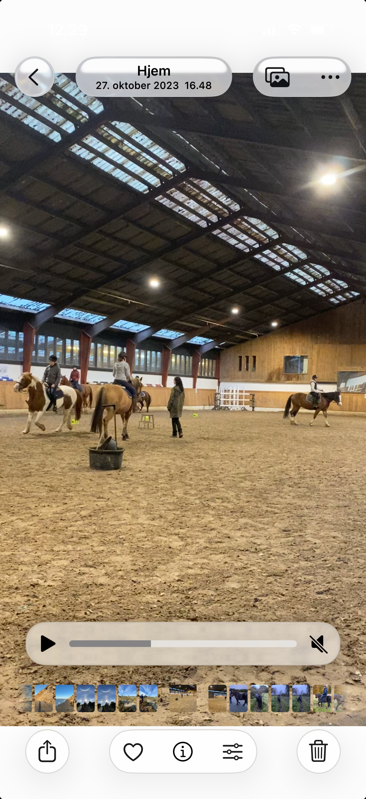

# CASE: Digital Holdadministration på Ridecenter

> [!WARNING]
> **Billede / Visuelt materiale (Side 1) – Ikke-tekstuelt indhold:**
> Dokumentet indeholder et integreret rasterbillede (1206x2622 px), som ikke kan oversættes til tekst via tekstekstraktion:
> - **Beskrivelse:** Foto / iPhone-skærmbillede fra ridehal med heste og ryttere under undervisning (mærket 'Hjem, 27. oktober 2023 16.48')
> - **Fil reference:** [`images/casebeskrivelse-side1-foto.png`](images/casebeskrivelse-side1-foto.png)
>
> 

---
 

# Om Bøgegårdens ridecenter

Bøgegårdens ridecenter i Strandby er en mellemstor rideskole, der foruden rideskolen huser 30 privatopstaldede heste, der fortrinsvis ejes af konkurrenceryttere inden for springning. 

Rideskolen ejes af Thomas og Malene, der begge underviser privatryttere og træner deres egne heste med henblik på videresalg. Malene driver rideskolen og underviser der tre eftermiddage om ugen. Deres datter, Stella, er konkurrencerytter på eliteplan, og Malene er ofte med hende i udlandet til stævner. 

Rideskolen modtager kommunal støtte som fritidstilbud til børn og unge og ridecenteret har derfor pligt til at holde styr på medlemslister og kontingenter, da konsekvensen ved uberettiget modtaget støtte kan være, at støtten bortfalder. Dette ville få alvorlige økonomiske konsekvenser for ridecenteret. 

Der er desuden i offentligheden en stigende opmærksomhed på dyrevelfærd i ridesporten. Malene og Thomas frygter ligesom mange andre i sporten, at ridning bliver forbudt. Men de holder også af deres dyr, og har regler for, hvor meget de må blive brugt i undervisningen. 

# Regler for hestevelfærd:

- Hesten må højst gå på 3 hold på en dag 

- Hesten skal have en ugentlig fridag 

- Syge eller skadede heste må ikke bruges 

- Hesten må højst springes en gang om ugen 

Der er fire faste ridelærere tilknyttet samt en række unge afløsere, typisk tidligere elever eller hesteejere på stedet. Der er desuden 2-4 hjælpere, der hjælper med at muge og fodre i stalden samt gøre heste klar, hvis forældrene ikke selv kan klare opgaven. Hjælperne ”aflønnes” med gratis ridning på et af dagens hold. 

# Ridelærerens opgaver:

- Møde 30 minutter før første undervisning, aftale dagens opgaver med hjælperne, inkl. deres gratis ridetime, og sørge for, at hestene bliver taget ind og gjort klar. 

- Undervise på holdene 

- Ride med i skoven, hvis der er skovtur 

- Tage imod børn og forældre til prøvetime 

- Sørge for fodring og udlukning af hest efter sidste ridetime 

- Sidste ridetime i en måned: indsamle ønsker fra eleverne til næste måneds hest 

- Tildele heste og opdatere afkrydsningslister inden næste ridetime 

# Eleverne:

- Får som udgangspunkt nye heste hver måned 

- Kan ønske op til tre heste til en ny måned 

- De eller deres forældre skal selv gøre hesten klar til ridning, hvis den ikke allerede er klar, og de skal selv tage udstyr af, hvis hesten ikke skal bruges mere. Nogle heste kan være vanskelige at håndtere i stalden 

- Nogle elever har rideangst eller andre udfordringer, f.eks. med opmærksomhed 

- Nogle forældre er hestekyndige, mens andre ikke ved noget om heste og ridning. 

- Data om de enkelte hestes, forældres og elevers adfærd og præferencer ligger som tavs viden hos den enkelte ridelærer. Nogle data kan være personfølsomme, hvis de bliver skrevet ned. 

- Et forkert match mellem hest og rytter kan føre til konflikter med forældre og stor uro under afviklingen af holdene. 

# Hestene:

- Er typisk rideskoleheste i en periode, hvorefter de bliver solgt videre. Så der er løbende udskiftning. 

- Kan have forskellige adfærdsproblemer, da det ikke er dyre og fine heste, der bliver rideskoleheste. 

- Kan være lettere eller sværere at ride, dovne eller friske 

- Har forskellig størrelse fra lille pony til stor hest. Det har betydning for, hvor tunge ryttere de kan bære. 

- Nogle heste er meget eftertragtede blandt eleverne 

# Holdene:

Ridning foregår i ridehus, på ridebanen udendørs eller ind imellem i skoven, hvis vejret er til det. Max. antal elever på et hold er 10. Eleverne kan rykke hold, hvis de skal op på næste niveau eller tiden ikke passer. Et hold kan også omkategoriseres fra f.eks. ”begynder” til ”letøvet”, hvis alle elever når et nyt niveau. 

- Trækhold: For elever, hvor hesten bliver trukket af deres forældre. Næsten alle heste kan bruges her. 

- Begynder: For elever, der kan ride selv, men er meget usikre. Trav og galop foregår én ad gangen og mor og far kan hjælpe med at trække. Ikke alle heste er egnet til begyndere. 

- Letøvede: For elever, der kan ride selv i en række bag andre ryttere. Eleverne kan trave og galoppere i en samlet række. 

- Øvede: For elever, der har god kontrol over hestene og kan ride rundt individuelt på ridebanen. 

- Springhold: Her øves springning. Ikke alle heste bruges til springning. 

- Parthold: Her rider den samme rytter den samme hest hver gang. Der er typisk venteliste til bestemte heste. Ikke alle heste har parter. 

# Jeres opgave:

AI har gjort det rentabelt at udvikle skræddersyede IT-systemer til brancher, der hidtil ikke har været digitaliserede. Din gruppe er et konsulentteam i en ”AI-native” startup, der har specialiseret sig i at udvikle disse systemer. 

Dansk Rideforbund vil bruge Bøgegårdens Ridecenter som et pilotprojekt for et system, der skal 

- Lette administrationen af hold 

- Sikre korrekt registrering af elever på holdene 

- Sikre korrekt registrering af fremmøde 

- Kunne dokumentere, at rideskolen overholder de krav til dyrevelfærd, de selv har sat op. 

- Øge sikkerheden ved at undgå åbenlyst forkerte matches af hest og rytter 

Bøgegården ønsker desuden, at systemet automatisk skal kunne tildele nye heste til rytterne hver måned under hensyntagen til rytternes egne ønsker. 

# Problemer med administrationen:

- Det tager lang (ulønnet) tid for ridelærerne at tildele nye heste hver måned ud fra elevernes ønsker 

- Holdlister opbevares i en A4-mappe med udprint i stalden og stemmer ikke altid overens med, hvad der er registreret på kontoret. 

- Ventelister til hold ligger fysisk hos Malene, og de bliver ikke altid opdateret. Holdene bliver ikke altid fyldt så godt op, som de kunne. 

   - Kommunikation med Malene foregår typisk via korte SMS’er 

- Beskeder om prøvetimer, syge heste, mm. skrives på et whiteboard i stalden. Dette opdateres ikke altid, så der kan dukke overraskelser op 

- Der er ingen overlevering mellem ridelærerne fra dag til dag. Der er ind imellem meget lidt overlevering til en vikar. 

- Ved uforudsete ændringer har ridelæreren meget kort tid til at træffe en beslutning, da der ikke er pauser mellem holdene. 

# Jeres opgave består i:

- At kortlægge nuværende relevante processer vha. BPMN (AS-IS) med korrekt annotation 

- At identificere spild og mulige fejlkilder via 5 Why’s (el. lign. metode) og SIPOC 

   - At udarbejde en gapanalyse og et bud på løft af den digitale modenhed 

- Kortlægge kapabiliteter og udarbejde et bud på en fremtidig digitaliseret proces vha. BPMN med korrekt annotation (TO-BE) 

- At foreslå en arkitektur, der muliggør fremtidige udvidelser, f.eks. en forældreapp, et hestemanagementmodul, eller integration med andre relevante systemer 

- At udarbejde en eller flere klikbare ”proof of concepts” (POC), evt. vha. AI eller i Figma på servicen, der kan pitches til Bøgegårdens ridecenter 

- At præsentere jeres analyse og koncept professionelt 

Denne opgave er en eksamensforudsætning, hvilket betyder, at den skal godkendes inden ordinær eksamen. Hvis opgaven ikke godkendes, har man brugt et eksamensforsøg.