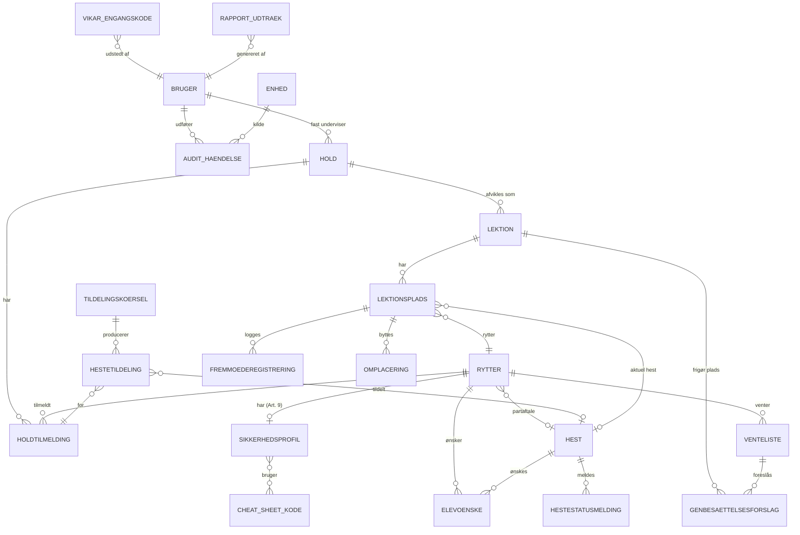
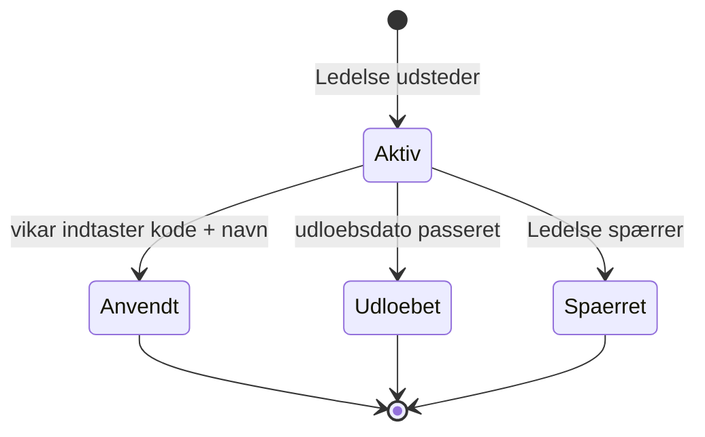
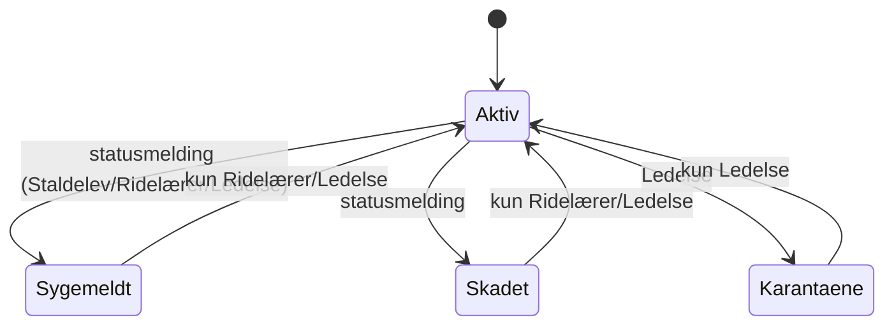
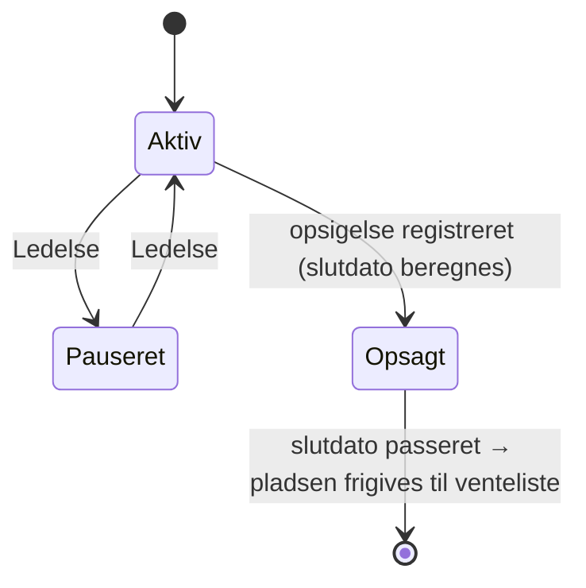
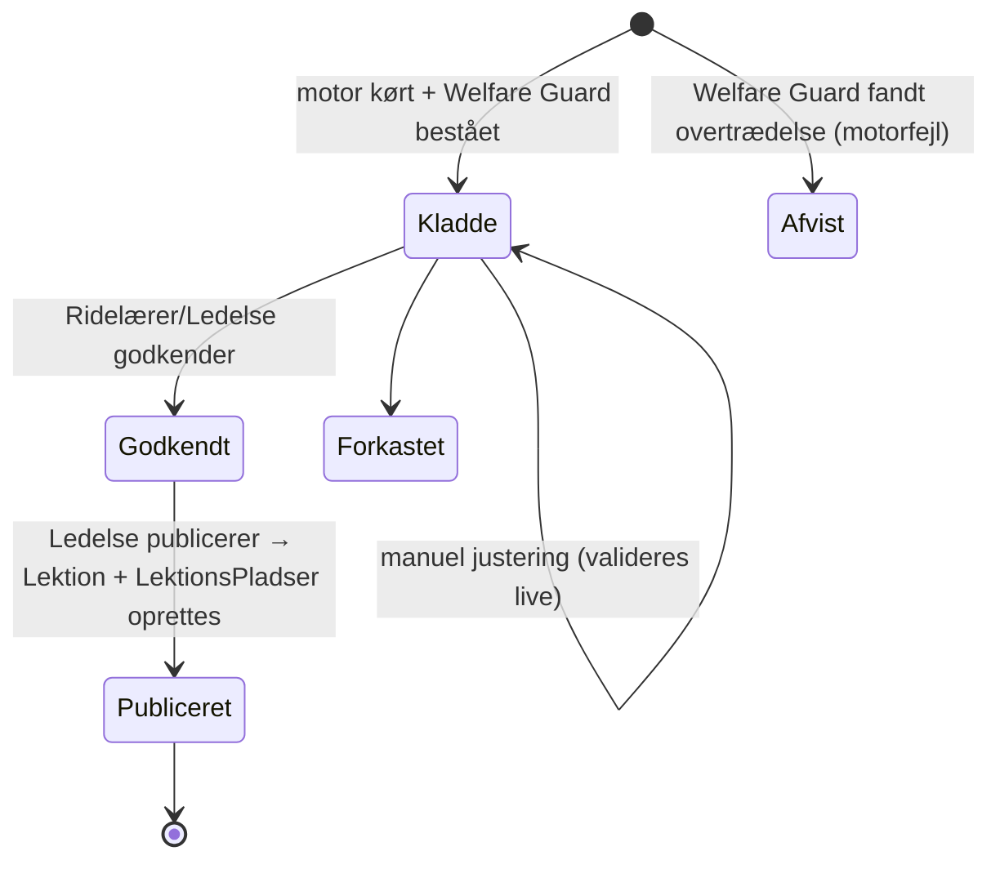

# Data Model: Digital Holdadministration & Ressourcestyring (POC)

**Fase**: 1 (Design) | **Dato**: 2026-10-06 | **Plan**: [plan.md](./plan.md) | **Research**: [research.md](./research.md)

Modellen udmønter spec'ens *Key Entities* til en relationel PostgreSQL-model (R3). Den adskiller **administrative stamdata** fra **følsomme sikkerhedsobservationer** (Princip IV). Afvigelser fra spec'ens entitetsliste er markeret **[Præcisering]** med begrundelse.

Konventioner: primærnøgler er UUID. Tidsstempler er `timestamptz` (UTC) og fortolkes i Europe/Copenhagen (R10). 🔒 = krypteret på applikationsniveau (AES-256-GCM, R8). 🧾 = append-only (UPDATE/DELETE afvises af en database-trigger, R3). ⛓ = indgår i hashkæden (R11).

---

## Oversigt (ER-diagram)

---

## 1. Personale, adgang og enheder

### Bruger (User/Staff)
| Felt | Type | Regler |
|---|---|---|
| id | uuid | PK |
| navn | text | påkrævet |
| roller | enum[] {`Ledelse`, `Ridelaerer`, `Vikar`, `Staldelev`} | mindst 1. En bruger kan have flere roller (Malene: Ledelse + Ridelærer) **[Præcisering]** |
| pin_hash | text | Argon2id af 4-cifret PIN. Unik pr. aktiv bruger på samme enhed. Påkrævet for staldroller |
| email, password_hash | text? | kun til web-login (Ledelse/Ridelærer) |
| aktiv | bool | inaktive brugere kan ikke logge ind. Historik bevares |

### Enhed (Device) **[Præcisering — ny entitet]**
Betroet stald-tablet/smartphone (R7).
| Felt | Type | Regler |
|---|---|---|
| id | uuid | PK |
| navn | text | f.eks. "Stald-tablet 1" |
| enrollment_token_hash | text | udstedt af Ledelse, kan bruges én gang |
| aktiv | bool | en deaktiveret enhed afvises ved sync og login |
| sidst_synkroniseret | timestamptz? | vises på dashboardet |

### VikarEngangskode (Substitute Access Token)
| Felt | Type | Regler |
|---|---|---|
| id | uuid | PK |
| kode_hash | text | 6-cifret kode (R7). Klartekst vises **kun én gang** ved udstedelse |
| udstedt_af | → Bruger (Ledelse) | |
| udstedt_dato, udloebsdato | timestamptz | standardudløb 90 dage |
| anvendt_dato | timestamptz? | |
| anvendt_af_vikarnavn | text? | påkrævet ved brug |
| anvendt_paa_enhed | → Enhed? | |
| status | enum | se tilstandsmaskine |

Ved `Aktiv → Anvendt` skal der oprettes en `AuditHaendelse(VIKAR_LOGIN)` og en `DashboardNotifikation(VIKAR_LOGIN)` med påmindelse om at udstede en ny kode (US3 AS2). Vikarsessionen udløber kl. 23:59 Europe/Copenhagen samme dag.

---

## 2. Heste

### Hest (Horse)
| Felt | Type | Regler / anvendelse |
|---|---|---|
| id | uuid | PK |
| navn | text | unik blandt aktive heste |
| stangmaal_cm | int | 80–190 |
| max_rytter_vaegt_kg | int | **HC-06**. Demoværdi afledt af stangmål, skal valideres af Malene (R15) |
| max_rytter_hoejde_cm | int? | **HC-06** (f.eks. Wally 115 cm → kun små og lette ryttere) |
| temperament | enum {`Rolig`, `Normal`, `Frisk`} | **HC-07** (nervøse ryttere: ikke `Frisk`), **SC-04** |
| godkendt_til_begyndere | bool | **HC-08**. Kun Ledelse kan ændre feltet (auditlogges). Startværdi `true` for Aslan, Toobi, Jane og Belle (forfatningen, spec-afklaring 2026-10-06) |
| egnet_oevet | bool | **HC-08** (Arthur = false) |
| skaane | bool | **HC-02**. Udleder `max_lektioner_dag` |
| max_lektioner_dag | int | afledt: `skaane ? 2 : 3`. Må ikke overstige afledt værdi |
| springforbud | bool | **HC-05** (Bølle, Wally, Aida = true) |
| max_spring_uge | int {0,1} | `springforbud ⇒ 0`, ellers 1 |
| hviledag | int {1–7} (ISO-ugedag) | **HC-03**. Ingen hold på denne ugedag |
| sundhedsstatus | enum {`Aktiv`, `Sygemeldt`, `Skadet`, `Karantaene`} | **HC-04**: kun `Aktiv` kan tildeles |
| staldnoter | text | **ikke-følsomme** håndteringsnoter, der vises i stalden (f.eks. "Sparker andre heste – hold afstand", "Svær at gøre klar pga. vorter") |
| aktiv | bool | solgte heste deaktiveres, historikken bevares |

**Validering**: `springforbud = true ⇒ max_spring_uge = 0`. `skaane = true ⇒ max_lektioner_dag = 2`. Ændring af `sundhedsstatus` til andet end `Aktiv` fører straks til en advarsel på berørte fremtidige lektionspladser (US3 AS3).

Fail-safe-princip: alle staldroller kan **sætte en hest ud**, men kun Ridelærer eller Ledelse kan **sætte den i drift igen**.

### Hestestatusmelding (F2.1) 🧾 **[Præcisering — ny entitet]**
| Felt | Type | Regler |
|---|---|---|
| id, hest_id | uuid | |
| type | enum {`Helbred`, `Adfaerd`} | |
| alvorlighed | enum {`Info`, `Obs`, `KanIkkeBruges`} | `KanIkkeBruges` sætter straks `Hest.sundhedsstatus = Sygemeldt` |
| beskrivelse | text | ≤ 500 tegn, kun om hesten |
| meldt_af_bruger_id, meldt_af_navn | | |
| klient_tidspunkt, server_tidspunkt | timestamptz | |
| kommando_id | uuid | idempotensnøgle (sync) |

---

## 3. Ryttere og følsomme data (Princip IV: to adskilte tabeller)

### Rytter (Rider/Student) — administrative stamdata
| Felt | Type | Regler |
|---|---|---|
| id | uuid | PK |
| fornavn, efternavn | text | |
| foedselsdato | date | tilskudskriterium: under 25 år ved rapportperiodens start (Ledelse kan justere grænsen). **Ingen CPR** (R8, spec-afklaring 2026-10-06) |
| bopaelskommune | text | **[Præcisering]** nævnt i spec'ens antagelser, mangler i entitetslisten (research D5) |
| hoejde_cm, vaegt_kg | int | **HC-06**. Synlig kun for Ledelse. Sendes **aldrig** til enheder (R6) |
| erfaringsniveau | enum {`Begynder`, `Letoevet`, `Oevet`} | |
| klar_til_udvikling | bool | **SC-04** |
| er_hjaelper | bool | **SC-05** (staldelev/hjælpepige) |
| kontaktperson_navn, kontakt_telefon, kontakt_email | text | vises på genbesættelsesforslag til Ledelse (US4 AS2) |
| partaftale_hest_id | → Hest? | **HC-08** |
| partaftale_godkendt_trods_niveau | bool | **HC-08**. Kun Ledelse kan sætte feltet (auditlogges). Uden markering bruges parthesten ikke på hold, hvis niveau hesten ikke er godkendt til (spec-afklaring 2026-10-06) |
| aktiv_status | enum {`Aktiv`, `Pauseret`, `Opsagt`} | |
| opsigelse_modtaget | date? | **FR-015** |
| slutdato | date? | afledt: sidste dag i opsigelsesmåneden + 30 dage (R10) |

### Sikkerhedsprofil (Special Safety Profile, GDPR Art. 9)
Egen tabel med 1:1 til Rytter. **Kun Ledelse** kan læse og skrive fuld profil.
| Felt | Type | Synlighed |
|---|---|---|
| rytter_id | → Rytter (PK/FK) | |
| faldtraume_note 🔒 | text | kun Ledelse |
| angstkategori 🔒 | text | kun Ledelse |
| intern_note 🔒 | text | kun Ledelse |
| cheat_sheet_koder | → CheatSheetKode[] | **stald** (Ridelærer/Vikar), kun koder og tekst |
| adfaerdsinstruks 🔒 | text (anonymiseret, ≤ 200 tegn) | **stald**, dekrypteret i stald-DTO. Valideres mod en liste af forbudte termer (diagnosebetegnelser) |
| forbudte_heste | → Hest[] | kun motor og Ledelse (**HC-07**) |
| paakraevede_heste | → Hest[] | kun motor og Ledelse (**HC-07**, f.eks. Anna → [Donny]; Filippa → [Aslan, Toobi]) |
| kun_rolige_heste | bool | kun motor og Ledelse (**HC-07**, nervøse ryttere) |
| opdateret_af, opdateret | | |

**Regel**: enhederne modtager aldrig `forbudte_heste`, `paakraevede_heste` eller årsagen til dem. De modtager kun den **afledte** `godkendte_heste`-liste pr. lektionsplads (R6).

### CheatSheetKode (katalog) **[Præcisering — ny entitet]**
| Felt | Type | Eksempel |
|---|---|---|
| kode | text PK | `OBS-SKAANSOM`, `AFSTAND-3M`, `TRAEK-OP-I-RO`, `HJAELP-OPSTIGNING`, `FORAELDRE-STOETTE` |
| tekst | text | "OBS: Følsom/skånsom håndtering påkrævet – se instruks" |
| kategori | enum {`Haandtering`, `Afstand`, `Opstigning`, `Kommunikation`} | |

---

## 4. Hold, tilmeldinger og ønsker

### Hold (Lesson/Class)
| Felt | Type | Regler |
|---|---|---|
| id | uuid | |
| holdnavn | text | f.eks. "Fredag 15:00 Begynder" |
| niveau | enum {`Traekhold`, `Begynder`, `Letoevet`, `Oevet`, `Parthold`} | **HC-08** |
| er_springhold | bool | **HC-05** |
| ugedag | int {1–7} | |
| starttid | time | |
| varighed_min | int | 30–60 |
| max_kapacitet | int | 1–10 (casen: max 10) |
| fast_underviser_id | → Bruger (Ridelærer) | |

### Holdtilmelding (Enrollment) **[Præcisering — spec'ens "Holdtilmelding & Tildeling" er delt i to]**
Spec'en samler tilmelding og månedlig hestetildeling i én entitet. De har forskellig levetid: en tilmelding gælder i måneder til år, en hestetildeling i én måned. Derfor er de delt.
| Felt | Type | Regler |
|---|---|---|
| id, rytter_id, hold_id | | unik (rytter, hold, gyldig_fra) |
| gyldig_fra, gyldig_til | date, date? | `gyldig_til ≤ Rytter.slutdato` ved opsigelse |
| ancienitet_dato | date | tie-breaker i motoren (R5) |

**Validering**: antal aktive tilmeldinger pr. hold ≤ `Hold.max_kapacitet`.

### Elevoenske (Rider Preference, F1.1)
| Felt | Type | Regler |
|---|---|---|
| rytter_id, maaned | uuid, char(7) `YYYY-MM` | |
| prioritet | int {1,2,3} | unik (rytter, maaned, prioritet) |
| oensket_hest_id | → Hest | unik (rytter, maaned, hest) |
| registreret_af | → Bruger | typisk ridelæreren i stalden (spec-antagelse) |

Ønsker, der rammer en spærret hest (HC-07), accepteres som registrering, men markeres "kan ikke opfyldes", og motoren springer dem over med årsagskode.

---

## 5. Månedlig tildeling (Kabalen)

### Tildelingskoersel (Allocation Run) **[Præcisering — ny entitet]**
| Felt | Type | Regler |
|---|---|---|
| id | uuid | |
| maaned | char(7) | |
| status | enum | se tilstandsmaskine |
| startet_af | → Bruger | |
| solver_version | text | f.eks. `mrv-greedy@1` (R5) |
| input_hash | text | SHA-256 af input. Samme input giver samme output (determinisme) |
| varighed_ms | int | måles mod SC-004 |
| statistik | jsonb | antal 1./2./3. ønsker, alternativer, ikke-tildelte, belastningsfordeling |
| welfare_guard_resultat | jsonb | **skal være tom** for at kunne godkendes |

Højst én `Publiceret` kørsel pr. måned. En ny publicering erstatter den gamle for fremtidige datoer og auditlogges.

### Hestetildeling (Assignment)
| Felt | Type | Regler |
|---|---|---|
| id, koersel_id, holdtilmelding_id | | unik (koersel, holdtilmelding) |
| hest_id | → Hest? | `null` = **Ikke tildelt – kapacitetsmangel** |
| oenske_opfyldt | int? {1,2,3} | |
| er_alternativ_tildeling | bool | `true` når ingen ønsker kunne opfyldes (US2 AS4) |
| turnus_score | int | prioritet brugt i kørslen (R5) |
| turnus_naeste_maaned | int | 0/+1/+2/+3 (R5) |
| begrundelse_koder | text[] | f.eks. `{SC01_OENSKE_2, HC01_DAGSGRAENSE:Toobi, SC02_TURNUS}` ([domain-engine.md](./contracts/domain-engine.md#4-årsagskoder)) |
| begrundelse_tekst | text | dansk forklaring (FR-010) |
| manuelt_justeret | bool | sat af manuel justering. Justeringen skal bestå Welfare Guard |

---

## 6. Daglig afvikling

### Lektion (Lesson Occurrence) **[Præcisering — ny entitet]**
En konkret afvikling af et hold på en dato. Oprettes ved publicering.
| Felt | Type | Regler |
|---|---|---|
| id, hold_id, dato | | unik (hold, dato). `dato.ugedag = Hold.ugedag` |
| underviser_id | → Bruger | fast underviser eller vikar |
| vikar_navn | text? | sat ved vikarlogin |
| status | enum {`Planlagt`, `Afviklet`, `Aflyst`} | `Planlagt → Afviklet` når fremmødet lukkes. `Planlagt → Aflyst` af Ridelærer/Ledelse (f.eks. ved kapacitetsmangel, edge case) |
| fremmoede_lukket | timestamptz? | sat af "Afslut hold" eller automatisk 30 min. efter lektionens slut. Herefter kræver ændringer begrundelse ([sync-protocol §3](./contracts/sync-protocol.md#åbent-fremmøde-og-korrektion)) |

### LektionsPlads (Seat) **[Præcisering — ny entitet]**
Rytterens plads på en konkret lektion. Den aktuelle hest kan afvige fra månedsplanen ved omplacering.
| Felt | Type | Regler |
|---|---|---|
| id, lektion_id, rytter_id | | unik (lektion, rytter) |
| planlagt_hest_id | → Hest? | fra Hestetildeling |
| aktuel_hest_id | → Hest? | felt-LWW ved sync (R4). Unik (lektion, aktuel_hest) |
| kilde | enum {`Plan`, `Venteliste`, `Hjaelper`} | |
| fremmoede_status | enum? | **afledt**: seneste Fremmøderegistrering |
| felt_tidsstempler | jsonb | `{aktuel_hest_id: klient_ts}` til LWW |

**Afledt dagsbelastning**: `belastning(hest, dato)` = antal pladser på datoen med `aktuel_hest_id = hest`, hvor seneste status **ikke** er et afbud. Afbud frigør derfor kapacitet (US4 AS1/AS3).

### Fremmoederegistrering (Attendance Record) 🧾 ⛓
| Felt | Type | Regler |
|---|---|---|
| id | uuid | |
| lektionsplads_id | → LektionsPlads | |
| lektion_dato, hold_id, rytter_id, hest_id | | denormaliseret til rapport og revision (spec-felter) |
| status | enum {`Fremmoedt`, `Afbud_rettidigt`, `Afbud_for_sent`, `Udeblevet`} | afbudsstatus beregnes af domænefunktionen (R10) og kan ikke vælges frit |
| modtaget_tidspunkt | timestamptz? | kun ved afbud (R10) |
| registreret_af_bruger_id, registreret_af_navn | | vikarer: navnet fra vikarlogin |
| klient_tidspunkt, server_tidspunkt | timestamptz | |
| enhed_id | → Enhed? | |
| erstatter_id | → Fremmoederegistrering? | sat ved korrektion |
| korrektions_begrundelse | text? | **påkrævet når `erstatter_id` er sat** (US1 AS5, FR-017) |
| kommando_id | uuid unik | idempotens (R4) |
| forrige_hash, hash | text | hashkæde (R11) |

**Afledt status** = rækken med størst `klient_tidspunkt` pr. lektionsplads (LWW). Opstår der flere forskellige statusser fra forskellige enheder inden for samme sync-vindue, logges `SYNK_KONFLIKT`.

### Omplacering (Horse Swap, F2.2) 🧾 ⛓
| Felt | Type | Regler |
|---|---|---|
| id, lektionsplads_id | | |
| fra_hest_id, til_hest_id | → Hest | `til_hest` skal bestå Welfare Guard på tidspunktet |
| aarsag | enum {`HestSyg`, `HestSkadet`, `Adfaerd`, `Andet`} | |
| forslag_snapshot | jsonb | top-3 som de blev vist, med rang og årsager |
| godkendt_af_bruger_id/navn, klient_tidspunkt, server_tidspunkt, kommando_id | | |

---

## 7. Venteliste, afbud og opsigelse

### Venteliste (Waitlist Entry)
| Felt | Type | Regler |
|---|---|---|
| id, rytter_id | | |
| oensket_hold_id | → Hold? | enten hold eller niveau skal være sat |
| oensket_niveau | enum? | |
| tilmeldingsdato | date | FIFO-rækkefølge |
| status | enum {`Aktiv`, `Forslag_genereret`, `Optaget`, `Afslaaet`} | |

### Genbesaettelsesforslag (Refill Suggestion) **[Præcisering — ny entitet]**
| Felt | Type | Regler |
|---|---|---|
| id | uuid | |
| type | enum {`Enkeltlektion`, `FastPlads`} | `Enkeltlektion` ved rettidigt afbud (FR-014). `FastPlads` ved opsigelse (FR-015) |
| lektion_id | → Lektion? | ved `Enkeltlektion` |
| hold_id, ledig_fra | | ved `FastPlads` (`Rytter.slutdato + 1`) |
| frigjort_hest_id | → Hest? | |
| foreslaaet_venteliste_id | → Venteliste | den øverste **kvalificerede** kandidat: niveau matcher, og kandidaten kan ride en ledig hest (HC-06/07/08) |
| kontaktinfo_snapshot | jsonb | navn og telefon til Malenes manuelle kontakt |
| status | enum | `Afventer → Godkendt / Afvist / Udloebet` (udløber ved lektionsstart) |
| behandlet_af, behandlet_tidspunkt | | |

**Regel**: oprettes **kun** ved `Afbud_rettidigt` på hold med en aktiv venteliste (US4 AS2). `Afbud_for_sent` giver intet forslag (US4 AS3).

---

## 8. Ledelse, revision og rapporter

### DashboardNotifikation **[Præcisering — ny entitet]**
| Felt | Type |
|---|---|
| id, type | enum {`VIKAR_LOGIN`, `GENTAGET_FRAVAER`, `SYNK_KONFLIKT`, `KAPACITETSMANGEL`, `HEST_UDE_AF_DRIFT`, `GENBESAETTELSESFORSLAG`, `PARTAFTALE_MANGLER_NIVEAUGODKENDELSE`} |
| payload | jsonb |
| oprettet, kvitteret_af, kvitteret_tidspunkt | |

### AuditHaendelse (generelt revisionsspor) 🧾 ⛓
| Felt | Type |
|---|---|
| id, server_seq (bigserial) | rækkefølge i hashkæden |
| server_tidspunkt, klient_tidspunkt | |
| enhed_id, bruger_id, bruger_navn, rolle | |
| handling | enum, f.eks. `LOGIN_PIN`, `VIKAR_LOGIN`, `FREMMOEDE_KORRIGERET`, `OMPLACERING`, `HEST_STATUS_AENDRET`, `TILDELING_PUBLICERET`, `SIKKERHEDSPROFIL_LAEST`, `SIKKERHEDSPROFIL_AENDRET`, `RAPPORT_GENERERET`, `SYNK_KONFLIKT` |
| entitet, entitet_id | |
| foer, efter | jsonb. **Krypterede felter logges aldrig i klartekst**, kun som "ændret" |
| begrundelse | text? |
| kommando_id | uuid? |
| forrige_hash, hash | |

Læsning af en fuld sikkerhedsprofil auditlogges også (Art. 9 adgangslog).

### RapportUdtraek (Kommunal tilsynsrapport) 🧾
| Felt | Type |
|---|---|
| id, periode_fra, periode_til, aldersgraense | |
| format | enum {`CSV`, `HTML`} |
| antal_raekker, fil_sha256, kaede_hovedhash | |
| genereret_af, genereret_tidspunkt, varighed_ms | (SC-009) |

---

## 9. Lokal enhedsmodel (IndexedDB på stald-tablet)

Kun det nødvendige for dagens drift (dataminimering, R6/R8). Alt slettes ved afmelding af enheden.

| Store | Indhold |
|---|---|
| `brugere` | id, navn, roller, PIN-hash (PBKDF2) — **ingen** e-mail eller adgangskode |
| `vikarkoder` | id, kode-hash, status (kun `Aktiv`) |
| `lektioner` | i dag + 6 dage frem: lektion, hold (navn, niveau, spring, tid), underviser |
| `pladser` | lektionsplads, rytterens fornavn + efternavnsinitial, aktuel og planlagt hest, afledt status, `godkendte_heste[]`, Cheat Sheet-koder og anonymiseret instruks |
| `heste` | id, navn, stangmål, temperament, sundhedsstatus, staldnoter, hviledag, max/dag, spring-tæller for ugen |
| `outbox` | kommandoer som ikke er synkroniseret ([sync-protocol.md](./contracts/sync-protocol.md)) |
| `meta` | sync-cursor, enheds-ID, sidste sync |

**Aldrig på enheden**: vægt, højde, fødselsdato, kontaktinfo, forbudte/påkrævede heste, faldtraume, angstkategori og interne noter.

---

## Krav → entitet-sporbarhed

| Krav | Entiteter |
|---|---|
| FR-001 | Hest |
| FR-002, FR-003 | Rytter, Sikkerhedsprofil, CheatSheetKode |
| FR-004, FR-005 | Bruger, Enhed, lokal model, Fremmoederegistrering |
| FR-006 – FR-010 | Elevoenske, Tildelingskoersel, Hestetildeling, Holdtilmelding |
| FR-011 | LektionsPlads, Omplacering |
| FR-012 | Sikkerhedsprofil (stald-projektion), CheatSheetKode |
| FR-013 | VikarEngangskode, DashboardNotifikation, AuditHaendelse |
| FR-014, FR-015 | Fremmoederegistrering (afbud), Genbesaettelsesforslag, Venteliste, Rytter.slutdato |
| FR-016 | DashboardNotifikation + afledte nøgletal |
| FR-017 | Fremmoederegistrering, Omplacering, AuditHaendelse (🧾 ⛓) |
| FR-018 | RapportUdtraek, Fremmoederegistrering |
